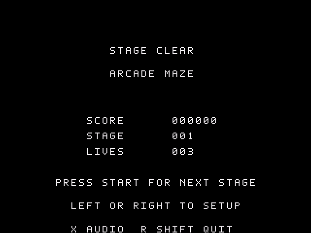

# zeal-tank

zeal-tank is a headquarters defence game for the Zeal 8-bit Computer, inspired by **Tank Battalion**. Drive your tank through destructible cover, intercept enemy shells and protect the base.

It runs at **640×480 @4bpp**, with animated tanks, explosions and sound effects.

The bespoke intro builds **ZEAL / TANK** from red brick fortifications, with
patrolling enemies, shell impacts and an eagle bunker beneath the title.

## Screenshots

| Splash Screen | Gameplay | Stage Complete |
| - | - | - |
|  |  |  |

These previews come from the actual C tilemap and sprite renderer using a host graphics model; they are not emulator screenshots.

## Rules

- Protect the headquarters at the bottom of the battlefield. A shell from either side can destroy it.
- Destroy **20 enemies** to complete a stage. Up to four enemies can be active at once.
- Start with **three lives**. Losing all your tanks or your headquarters ends the game.
- Move and fire in four directions. You can have one shell in flight; enemies share a limit of two shells.
- Red brick cover breaks in strips when hit. The green battlefield boundary remains solid. Opposing shells cancel each other, and explosions absorb shells.
- Close frontal hits earn more points. Earn one bonus life when your score first reaches **20,000**.
- New tanks have a short protection period and stay visible while it lasts.
- Play eight distinct layouts, then cycle through them with stronger enemy pressure. Score and lives carry over between stages.

The first maze is reconstructed from arcade screenshots; the other seven are arcade-style variants, not verified copies of all original mazes. The original red brick, eagle and multicolour player tank tiles are restored. Enemies use the same detailed tank geometry with contrasting cyan shades, dark tracks and white highlights. Movement timings and distance bands remain Zeal adaptations. This is single-player against computer-controlled enemies.

## Controls

- `ENTER` or SNES `START`: leave the intro, start a game, or continue after a stage.
- Arrow keys or SNES D-pad: move and aim.
- Press `SPACE` / `Z` or SNES `B`: fire one shot. Release and press again for another shot. A press while your shell is still in flight is ignored rather than queued.
- `P` or SNES `A`: pause or resume. `ENTER` / SNES `START` also pauses during play.
- `X` or SNES `X`: toggle audio.
- `RIGHT_SHIFT` or SNES `SELECT`: pause during play; quit from pause, intro, setup or results.
- In setup, `UP` / `DOWN` selects difficulty or engine sound; `LEFT` / `RIGHT` changes the setting.
- On a result screen, `LEFT` / `RIGHT` returns to setup.

Keyboard controls take ownership of movement and firing. Press SNES `START` to switch back to the controller. Engine sound is optional and defaults to off. Release the fire button after starting or continuing before firing a shot.

## Game Flow

1. Release any key held while launching, then press Start at the flashing **PRESS START TO PLAY** prompt.
2. Choose difficulty and optional engine sound, then start the campaign.
3. Defend the headquarters and clear the enemy wave.
4. Watch the final explosion, then read the stage summary. Release fire/Start and press again after the brief guard to continue.
5. After game over, start a new campaign or return to setup.

## Build

Use ZDE from this project directory. It supplies the Docker build environment:

```sh
zde cmake
```

The playable binary is **`bin/ztank`**. Assets are embedded, so send this binary to a friend who already has a compatible Zeal Native Emulator and Zeal OS setup.

To use the normal emulator shell, run `zeal-native` from this project folder, then enter:

```text
H:
cd bin
./ztank
```
## Development

After building, run the gameplay, input, audio and rendering checks:

```sh
python3 tools/run_checks.py
```

## Reference

The game takes its rule reference from the [Tank Battalion service manual](https://arcarc.xmission.com/PDF_Arcade_Manuals_and_Schematics/Tank_Battalion_Service_Manual_%28Upright%29.pdf) and its visual reference from the [publisher's arcade screenshots](https://www.arcadearchives.com/en/title/aca-298/). Tank Battalion is a Namco game. The prototype artwork is retained in the source library; arcade identity colours and additional animation/effects are applied in the playable assets.
